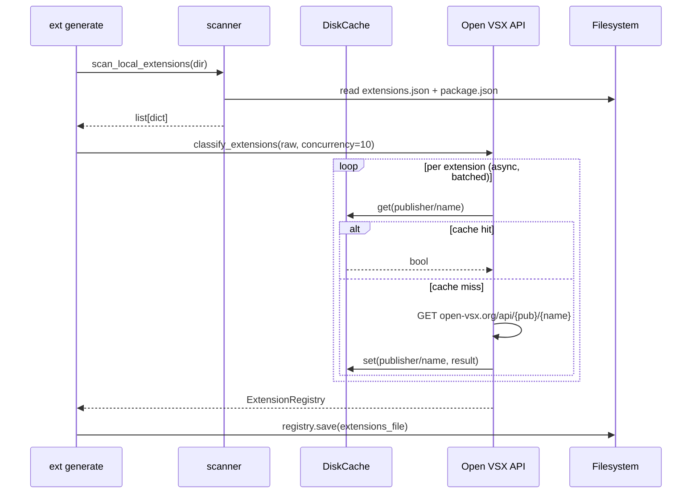
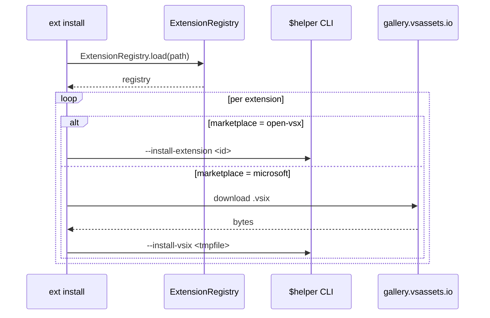

# Architecture

## Layers

`ext-tool` is structured in three layers:

```
┌──────────────────────────────────────────────────┐
│                    CLI Layer                     │
│   typer app · commands · rich output · context   │
├──────────────────────────────────────────────────┤
│                  Service Layer                   │
│       scanner · marketplace · classifier         │
├──────────────────────────────────────────────────┤
│                   Data Layer                     │
│     models · config · cache · logging            │
└──────────────────────────────────────────────────┘
```

---

## ext generate flow



---

## ext install flow



---

## Key design decisions

**Async only at the classification boundary**

Open VSX checks are the only I/O-bound parallel operation. All other operations
(install, scan, export, import) are synchronous. `asyncio.run()` is called once at
the CLI boundary to keep the rest of the codebase simple.

**AppConfig via pydantic-settings**

Config resolution (env vars → config file → defaults) is handled by pydantic-settings
without custom parsing logic. The config object is constructed once per invocation and
passed through Typer's context object (`ctx.obj["config"]`).

**Disk-backed TTL cache**

Open VSX API results are cached to disk for 5 minutes (configurable). This prevents
repeated network calls when running `ext generate` multiple times in a short window,
and the cache file is persisted across processes.

**Extension IDs are always lowercase**

A `field_validator` on `Extension.id` and `Extension.publisher` normalises on entry.
This prevents case-sensitivity bugs in lookups and ensures TOML round-trips are stable.

**TOML as the canonical registry format**

The registry TOML is human-readable and includes a header comment with generation
timestamp and marketplace counts. It is designed to be committed to dotfiles repos
without modification.

**Marketplace routing is declarative**

The `marketplace` field in each `Extension` record drives routing at install time.
No heuristics or re-classification is needed during `ext install` — the decision
is made once at generate time and stored.
